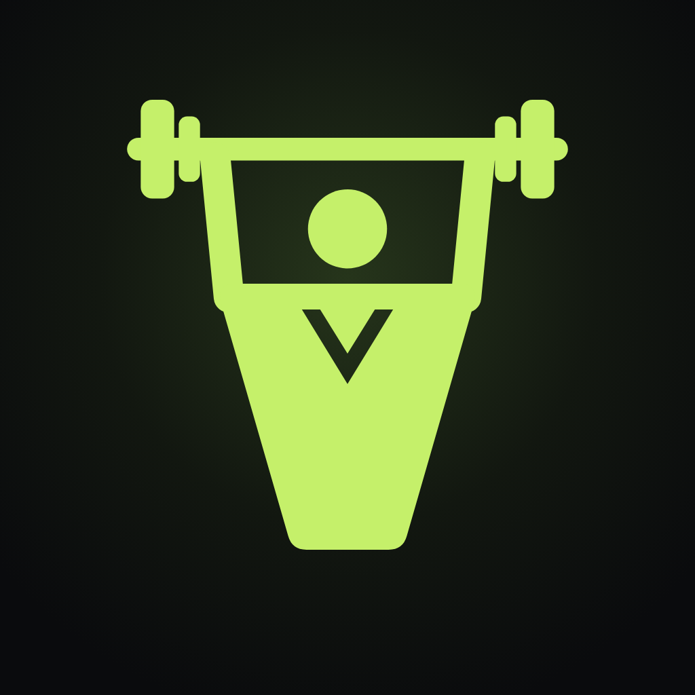
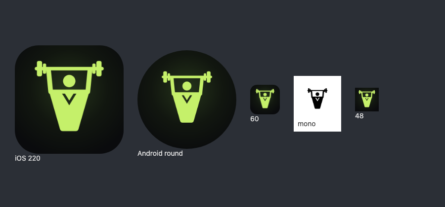

<p align="center"></p>

# Recomp

Recomp is a gym and calisthenics tracker for **body recomposition** that leads to a **ripped** physique: building
muscle and losing belly fat at the same time until you're at about 10% body fat with visible abs and an athletic
V-taper (broad shoulders, wide back, small waist). It is built for someone who
trains at a commercial gym with real equipment (machines, cables, barbells, dumbbells, kettlebells and cardio
machines) and needs the app to keep up between sets: big buttons, a target on every exercise, and a swap when a
machine is taken.

**This repository is the mobile app.** It is a single React Native (Expo) app that runs on Android and iOS (and
in a browser for development). Everything is stored on the phone, so it needs no account, no server, and no
signal in the gym.


## Tech stack

| Concern          | Choice                                                                                   |
| ---------------- | ---------------------------------------------------------------------------------------- |
| Framework        | [Expo](https://expo.dev) SDK 58 on [React Native](https://reactnative.dev) 0.88 and React 19.3 |
| Language         | [TypeScript](https://www.typescriptlang.org) 6 (strict)                                  |
| Navigation       | [Expo Router](https://docs.expo.dev/router/introduction/), file-based routes in `src/app/`, typed routes |
| Storage          | [expo-sqlite](https://docs.expo.dev/versions/latest/sdk/sqlite/) (WAL, versioned migrations), fully offline |
| Notifications    | [expo-notifications](https://docs.expo.dev/versions/latest/sdk/notifications/) local notifications: rest timer, meal and workout reminders |
| Feedback         | [expo-haptics](https://docs.expo.dev/versions/latest/sdk/haptics/), vibration, [expo-keep-awake](https://docs.expo.dev/versions/latest/sdk/keep-awake/) during workouts |
| Graphics         | [react-native-svg](https://github.com/software-mansion/react-native-svg): a small 3D renderer for exercise demos, plus charts |
| Icons            | [@expo/vector-icons](https://docs.expo.dev/guides/icons/) (Ionicons)                     |
| Web (dev only)   | [react-native-web](https://necolas.github.io/react-native-web/) with the SQLite web worker |
| Testing / lint   | [Jest](https://jestjs.io) via jest-expo, [ESLint](https://eslint.org) (eslint-config-expo, React Compiler rules), `tsc --noEmit`, `expo-doctor` |
| Builds           | [EAS Build](https://docs.expo.dev/build/introduction/) for installable Android/iOS apps |

## Contents

- [Features](#features)
- [How a training day works](#how-a-training-day-works)
- [Architecture](#architecture)
- [Project structure](#project-structure)
- [Getting started](#getting-started)
- [Configuration](#configuration)
- [Data and backups](#data-and-backups)
- [Development and testing](#development-and-testing)
- [Branding](#branding)

## Features

- **Programs built for the V-taper.** Three ready programs: *Aesthetic V-Taper* (the default four-day A→B→C→D
  rotation: chest and back width, legs and abs, shoulders and arms, kettlebell conditioning and running),
  *Recomp Basics* (three days) and *Kettlebell & Conditioning*. Weekly set targets are higher for side and rear
  delts, lats and upper chest, the muscles that make the shape. Every routine is editable.
- **A rotation, not a calendar.** Today offers the routine after the one you did last, whatever the day. Miss a
  session and nothing breaks. *Express* runs a ~20-minute version, and *Freestyle* starts an empty session.
- **Fast set logging.** Large −/+ steppers for weight and reps (hold to repeat), one tap to complete a set, kg or
  lbs, timed holds, and cardio logged as minutes plus optional distance.
- **Progressive overload on every exercise.** Double progression: add reps across the range, then add weight
  (2.5 kg barbell, 2 kg dumbbell, 4 kg kettlebell). The target card says exactly what to beat today, and suggests
  a deload or a harder variation when it's time.
- **79 exercises with 3D demos that show the muscles working.** Gym machines, free weights, cables, kettlebells,
  cardio machines and calisthenics. Each demo is a lean, athletic mannequin (V-taper torso, pecs, six-pack, lats,
  delts, arms and legs) that you can drag to rotate. The muscles the exercise works glow red (main) and amber
  (assisting), pulsing with each rep, with a legend naming them; cardio also shows the heart and lungs working.
  Each one also has form cues, easier and harder versions, and alternatives for when the equipment is busy.
  Add your own custom exercises.
- **Swap anything mid-workout.** Machine taken? Pick an alternative for today only, with a still 3D preview of each option.
- **Rest timer that works in your pocket.** Ring countdown, ±15 s, sound and vibration, and a scheduled local
  notification so it still alerts you with the phone locked.
- **Meals at the right times.** Breakfast, lunch and dinner at your own times (snacks any time). The Food tab
  opens on the meal for the time of day, shows a protein and calorie aim for that meal, and suggests foods that
  suit it (protein first). There are about 50 editable starter foods, with real macros, across protein, carbs,
  veg, fruit, healthy fats, drinks and a *limit for now* list.
- **Reminders.** A notification 15, 30 or 60 minutes before each meal, and before training on your gym days.
  Tapping one opens the Food or Today screen.
- **Today's plan.** Meals and the workout for today in time order, with the next one highlighted.
- **Road to ripped.** Add your neck and waist at check-in (plus your height once) and the app estimates your body fat
  with the US Navy tape method, shows how far you are from the ~10% ripped target, how much fat is left to lose and a
  realistic timeline, and puts you in a phase: *Lean out* (500 kcal deficit), *Get ripped* (400) or *Stay ripped &
  build* (maintenance). Your calorie target and cardio follow the phase.
- **Progress that tracks the recomp.** Waist (the main scoreboard), weight, shoulder-to-waist V-taper ratio
  (target ~1.6), body fat and waist-to-height ratio, with charts. Also weekly sets per muscle against your program's
  targets, weekly cardio minutes, and personal records with a per-exercise trend.
- **Everything offline.** SQLite on the phone, with JSON export and import for backups.

## How a training day works

1. **Morning.** A reminder fires 30 minutes before breakfast. Food opens on *Breakfast* with today's protein aim
   and suggestions (oats, eggs, Greek yogurt); one tap logs each.
2. **Before the gym.** On a training day, a reminder fires before your usual gym time. Today shows the next
   routine in the rotation and today's plan.
3. **Training.** *Start workout* opens the logger. The first time you do an exercise, its 3D demo opens
   automatically. Each exercise shows a target from your last session. Log each set, rest with the timer, and
   swap anything that's taken. New PRs get a toast and confetti.
4. **Finish.** The session summary shows time, sets and volume. Add a note, save it, and it appears in History.
5. **Weekly check-in.** Weight, waist and (optionally) shoulders and neck, measured the same morning each week.
   Progress updates the trends, Today updates your body fat and phase on the road to ripped, and Food uses your
   weight and phase to set protein and calorie targets.

## Architecture

The app is **offline-first and layered**: screens never talk to SQLite directly, and the training logic is
plain TypeScript with no React or Expo imports, so it is unit-tested in isolation.

- `src/app/` holds **only routes** (Expo Router): every file is a screen, and `_layout.tsx` files define the
  navigators (a root stack with the tab group, the full-screen workout, the check-in modal and Settings).
- `src/db/` is the **only module that touches SQLite**. It runs migrations (`PRAGMA user_version`), seeds the
  default program and foods, and exposes typed functions. A small reactive store (`useQuery`, a version counter
  and `useSyncExternalStore`) re-renders screens after any write.
- `src/lib/` is **pure logic**: progression, PRs and volume, nutrition targets, meal times, units, and the 3D
  pose and renderer engine. Side-effecting helpers (notifications, haptics, reminders) are kept in their own
  files (`alerts.ts`, `reminders.ts`).
- `src/data/` is **static content**: exercises, programs and starter foods.
- `src/components/` is the **UI kit** (design tokens in `src/theme.ts`) and reusable pieces: the 3D exercise demo,
  the rest timer and the exercise picker.
- **Reminders are idempotent.** Meal and workout notifications use fixed identifiers, and they are re-synced on
  launch and whenever the schedule changes, so editing a time replaces the old notification instead of adding
  another.

See [docs/DESIGN.md](docs/DESIGN.md) for the data model, the programs, the progression rules and the
animation system.

## Project structure

```
src/
  app/                    Routes (Expo Router); every file is a screen
    _layout.tsx             Root stack: runs migrations, sets up notifications, syncs reminders, handles taps
    (tabs)/                 The tab bar
      _layout.tsx             Today, History, Food, Progress, Plans
      index.tsx               Today: next workout, today's plan, week stats, check-in nudge, what speeds results
      history.tsx             Past workouts, every set, delete
      food.tsx                Daily targets, breakfast/lunch/dinner/snacks, suggestions, food list and editor
      progress.tsx            Body stats, V-taper, trends, weekly sets per muscle, cardio, PRs
      plans.tsx               Program picker, routine editor, exercise library, custom exercises
    workout/[id].tsx        Full-screen logger: exercise strip, demo, target, sets, rest timer, swap, finish
    checkin.tsx             Weekly weight / waist / shoulders (modal)
    settings.tsx            Units, height, meal times and reminders, gym days and time, nutrition, backup
  components/
    ui.tsx                  Design system: Screen, Section, Card, Btn, Stepper, Sheet, Segmented, Toggle, LineChart…
    ExerciseDemo.tsx        Animated, drag-to-rotate 3D exercise demo (SVG)
    RestTimer.tsx           Timestamp-based rest timer with a notification at the end
    ExercisePicker.tsx      Search and filter by muscle and equipment
    anim.tsx                FadeIn, Pop, Glow, Pulse, AnimatedBar, Burst (confetti)
  db/index.ts             SQLite schema, migrations, queries, reactive store, backup import/export
  data/                   exercises.ts (79), programs.ts (3), foods.ts (~50 + meal suggestions)
  lib/
    progression.ts          Double-progression suggestions (strength, holds, cardio)
    stats.ts                e1RM, PRs, weekly sets per muscle, cardio minutes, V-taper ratio
    nutrition.ts            Protein and calorie targets (deficit follows the phase), totals
    ripped.ts               US Navy body-fat estimate, phases, fat left to lose and timeline
    meals.ts                Meal times, which meal it is now, per-meal shares, today's schedule
    reminders.ts            Daily meal and weekly workout notifications
    alerts.ts               Notification channels and permission, rest alert, haptics
    session.ts              Next routine, express plan, starting a session
    units.ts                kg/lbs, cm/in, km/mi, formatting
    demo/                   poses.ts (keyframed skeletons, 2-link IK), render3d.ts (athletic mannequin, projection,
                            shading, muscle highlights, auto-framing), muscles.ts (what each demo highlights)
    *.test.ts               Unit tests next to the code they cover
  theme.ts                Colours, radii, tap-target size
  types.ts                Domain types and default settings
assets/
  icon.png, android-icon-*.png, splash-icon.png, favicon.png
  brand/                  mark.svg (logo source), render-icons.mjs, logo-preview.png
docs/DESIGN.md            Design notes
```

## Getting started

### Prerequisites

- [Node.js](https://nodejs.org) 20+ and npm
- A phone with **Expo Go** that supports **SDK 58** ([Android](https://play.google.com/store/apps/details?id=host.exp.exponent),
  [iOS](https://apps.apple.com/app/expo-go/id982107779)), or an emulator or simulator

### Run it on your phone

```sh
# 1. Install dependencies
npm install

# 2. Start the dev server
npx expo start
```

Then scan the QR code. On Android, use Expo Go's scanner. On iPhone, use the Camera app. The phone and computer
must be on the same Wi-Fi, or use `npx expo start --tunnel`.

**Over USB (Android).** With USB debugging on, forward the port and open the app directly:

```sh
adb reverse tcp:8081 tcp:8081
adb shell am start -a android.intent.action.VIEW -d "exp://127.0.0.1:8081" host.exp.exponent
```

**In a browser.** Press `w` in the dev server, or open http://localhost:8081. This is good for layout work.
Notifications, haptics and keep-awake only work on a phone.

### Install it as a real app

Expo Go needs the computer running. For a standalone app with the Recomp icon:

```sh
npx eas-cli@latest login
npx eas-cli@latest build -p android --profile preview   # an .apk you can install directly
```

iPhone builds need an Apple Developer account and `-p ios`.

## Configuration

There are no environment variables or servers. Everything is configured in the app under **Today → ⚙ Settings**
and saved on the phone.

| Setting                         | Default                 | Description |
| ------------------------------- | ----------------------- | ----------- |
| Weight unit / length unit       | `kg` / `cm`             | Logging and display units (lbs, inches; distances follow as km or mi). |
| Height                          | (none)                  | Used for the waist-to-height ratio on Progress. |
| Meal times                      | `08:00` / `13:00` / `19:00` | Breakfast, lunch and dinner. They decide which meal Food opens on and when reminders fire. |
| Remind me before each meal      | Off                     | Off, 15 min, 30 min or 1 h before each meal, every day. |
| Training days / usual time      | Mon, Tue, Thu, Fri / `18:00` | Shown on Today's plan and used for the workout reminder. |
| Remind me before training       | Off                     | Off, 15 min, 30 min or 1 h before training, on training days only. |
| Default rest                    | `90s`                   | Rest for exercises you add yourself (program exercises carry their own). |
| Weekly cardio target            | `120` min               | Shown on Today and Progress. |
| Sound / vibrate when rest ends  | on / on                 | Rest-timer alert. "Send a test alert in 5s" checks it with the phone locked. |
| Daily protein                   | `2.0` g per kg          | 1.6–2.2 g/kg of your latest check-in weight. |
| Daily calorie target            | estimated               | Blank = maintenance estimate (weight × 31) minus the phase deficit (500 / 400 / 0; 400 before a body-fat estimate). Lower it by ~150 if your waist hasn't moved in 3–4 weeks. |
| Program                         | Aesthetic V-Taper       | Changed on Plans. It sets the routines and the per-muscle weekly set targets. |

"Send a test reminder in 10s" (in the reminders section) checks that notifications are allowed on the phone.

## Data and backups

- **Where it lives.** One SQLite database (`recomp.db`) in the app's private storage. Migrations run on launch,
  and the schema version is kept in `PRAGMA user_version`.
- **What is stored.** Settings, routines, custom exercises, sessions and sets, check-ins, foods, and food logs (each
  log keeps its own macros, so editing a food never rewrites history).
- **Backups.** Settings → *Export* shares the whole database as JSON (save it to Drive or email it to
  yourself). *Import* replaces everything with a backup. *Erase all data* starts fresh.

## Development and testing

```sh
npm test               # Jest unit tests (progression, PRs, volume, nutrition, meals, 3D poses and renderer)
npm run typecheck      # tsc --noEmit
npm run lint           # expo lint (includes React Compiler rules)
npx expo-doctor        # dependency and config checks
npx expo install --fix # align package versions with the SDK
```

The tests cover the logic, not the screens. They check every exercise has a demo that stays in frame through the
whole rep and camera swing, with planted feet and constant limb lengths, that every program references real exercises, that the progression and PR
rules hold, that meal times, reminder times (including across midnight) and per-meal targets add up, and that the
body-fat estimate, phases and timeline behave. Run
lint and typecheck before every commit.

New dependencies go through `npx expo install <package>` so versions match the SDK. If a library with native code
is added, Expo Go can no longer run the app, and a development build is needed (`eas build --profile development`).

## Branding

The logo is a lifter pressing a barbell overhead: wide shoulders and a narrow waist, the V-taper the app trains for.
It is lime (`#C5F06A`) on near-black (`#0A0B0D`), the app's accent and background colours. The source is
[`assets/brand/mark.svg`](assets/brand/mark.svg). After editing it, regenerate every icon size with
`node assets/brand/render-icons.mjs` (needs `playwright-core` and Google Chrome).

<p align="center"></p>
